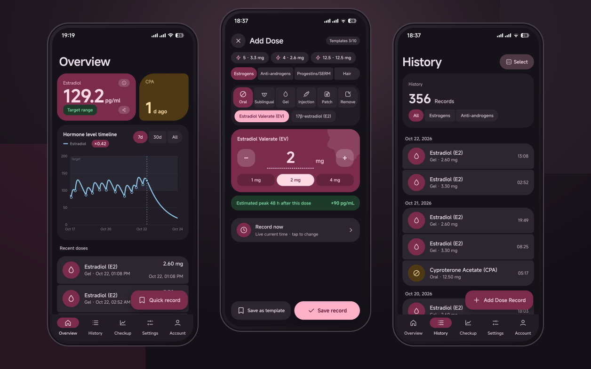
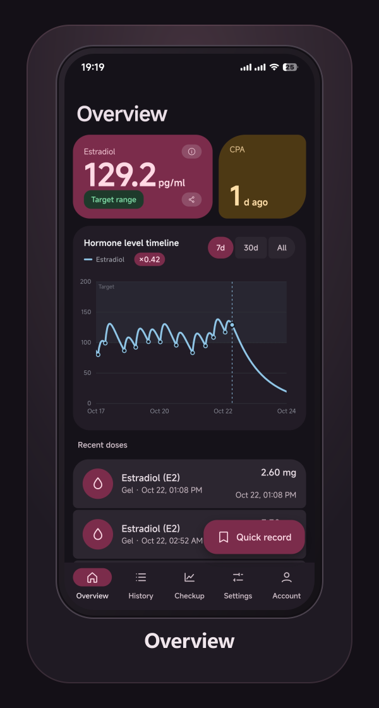
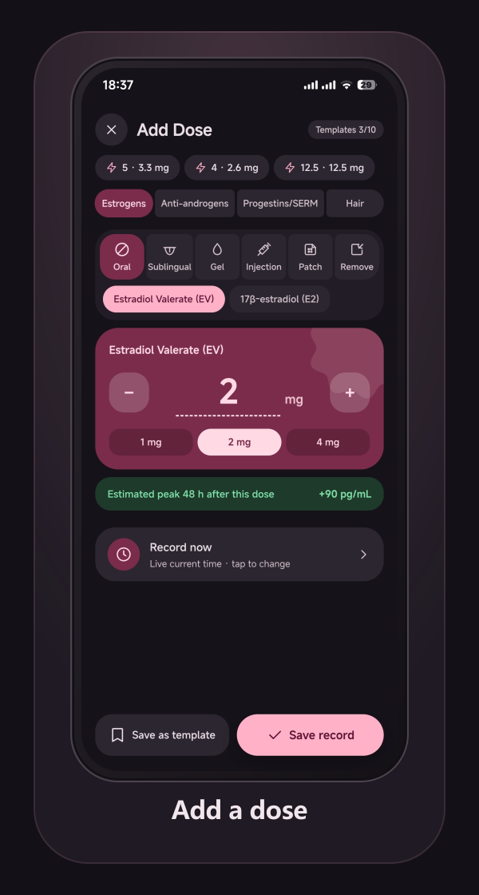
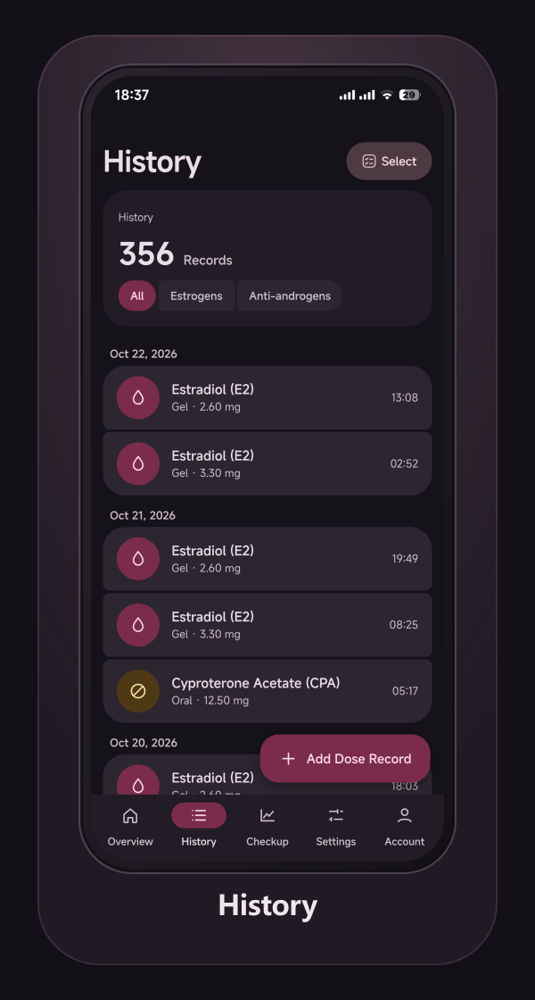
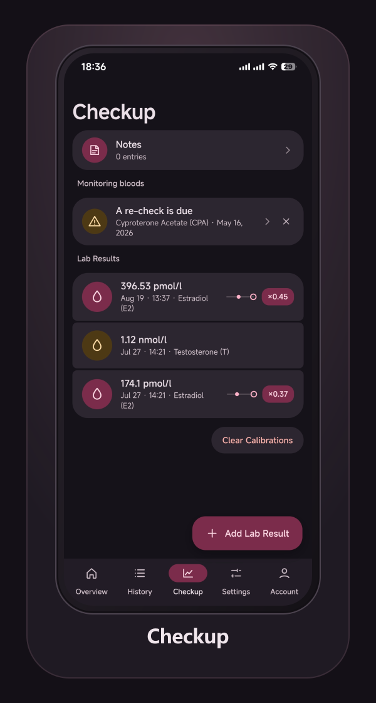
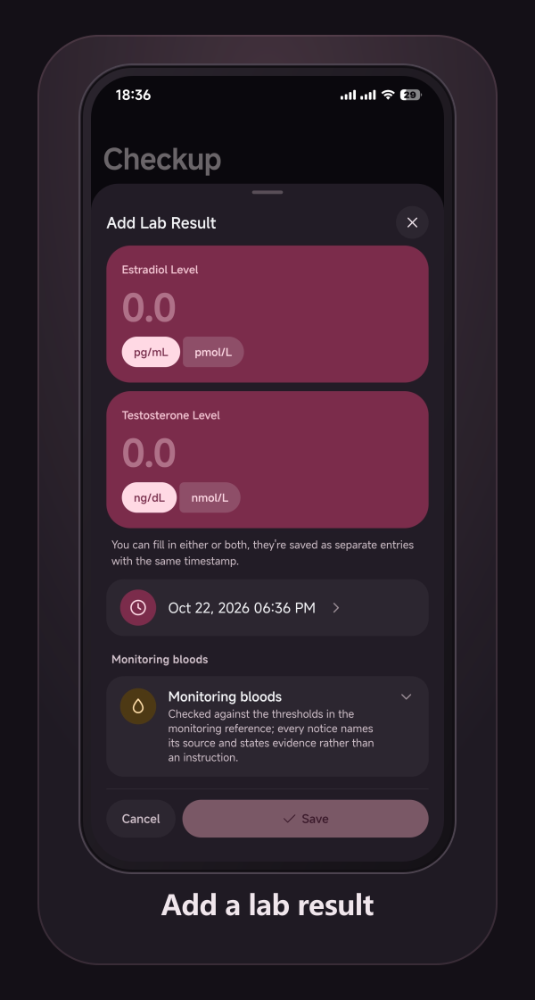
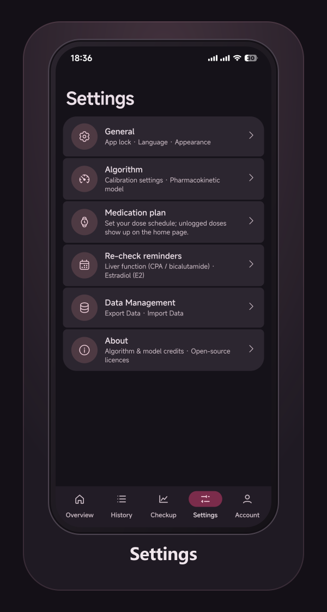

# Kira HRT Tracker

**English** · [中文](README.md)



**Log HRT doses and blood tests → estimate a hormone-level curve with a population
pharmacokinetic model → calibrate it to your own lab results → let an AI assistant read
and write the same records over MCP.**

One Application Core behind a web app, an Android app and an MCP server, with cloud sync
and per-account encryption.

Built by **[KiraEqual](https://kiramyao.com)** · [About](https://hrt.kiramyao.com/about/en/) · Service status <https://status.kiramyao.com>

> ⚠️ The estimates come from a **population pharmacokinetic model**, not from a blood test, and
> **must not be used to decide a dose**. The only way to know your actual level is to have blood
> drawn — always go by your clinic's report.

---

## Contents

- [What it is](#what-it-is)
- [Features](#features)
- [Screenshots](#screenshots)
- [About](#about)
- [Architecture](#architecture)
- [Two pharmacokinetic models and calibration](#two-pharmacokinetic-models-and-calibration)
- [AI assistants (MCP)](#ai-assistants-mcp)
- [Import / export](#import--export)
- [Tech stack](#tech-stack)
- [Local development](#local-development)
- [Self-hosting](#self-hosting)
- [Security and privacy](#security-and-privacy)
- [Upstream and credits](#upstream-and-credits)
- [Licence](#licence)

---

## What it is

A tracker for HRT, built around one loop:

**log a dose → the model estimates a concentration curve → enter your blood-test results →
the model adjusts toward you specifically**

It suits someone who injects or uses gel and wants to know "roughly where is my level this
week", "when should I get the next blood test", "was that dose too high" — and who wants
those records to be readable by an AI assistant.

Your data lives in **your own account** and syncs across devices. No third-party analytics,
no advertising.

## Features

### Records

- **Doses** — injection / oral / sublingual / gel / patch. Gel carries the product, the
  application area, what else was on the skin, and the wash-off time; sublingual carries an
  absorption tier.
- **Patch-wearing tracking** — after applying, the overview shows how long a patch has been
  worn, with a one-tap "remove" that ties the removal to the matching patch.
- **Blood tests** — value, unit (pg/mL, pmol/L, ng/dL, nmol/L), and monitoring-only entries
  (liver function, potassium, …).
- **Medication plans** — route, first time, extra doses, interval, drug and amount, on one of
  three cadences ("N times a day", "every x hours", "every x days"); overdue doses highlight on
  the home screen with one-tap logging.
- **A private body journal** — subjective notes read alongside the dose timeline.
- **Quick templates** — save a common dose and log it in one tap from the home screen, with undo.
- **Batch add**, **import and export**.

### Estimates and calibration

- **Concentration curve** — line or candlestick (OHLC); current level; dose-level reference.
- **Individual calibration** — four estimators: off / MIPD (MAP fitting) / EKF (extended Kalman
  filter) / OU-Kalman (Ornstein–Uhlenbeck dynamic calibration), each with a live preview animation.
- **Two engines**, switchable: the built-in engine and the Transmtf engine draw different curves
  from the same records.

### Reminders

- **Re-check reminders** — prompts for liver function, potassium and estradiol on the cadence
  MtF.wiki recommends.
- **Anti-androgen cumulative tracking**.
- **Medication reminders** — a local, scheduled notification is the on-time ring; a server-side
  FCM push is the catch-up (with **double deduplication**). Notification language follows the
  in-app language setting.

### Lab-report scanning

Photograph a report; recognition happens **on-device** (ONNX detection plus text recognition) and
the image never leaves the device.

### Accounts, sharing and sync

- **Accounts** — username + password; X (Twitter) and Google sign-in that complement and can bind
  to each other.
- **Device session list** — see and revoke each signed-in device.
- **Cloud sync** — records and settings across devices, medication plans included. Sync is
  **incremental**: the server stamps each write with a change version, so a client pulls only
  what changed since its last sync and uploads only the records it touched. An idle sync
  transfers almost nothing.
- **Sharing** — a read-only link for a doctor or a friend, with an optional expiry and password,
  containing **only what you chose to share**.
- **Data export and deletion** — export everything; delete the account outright.

### Clients

- **7 languages** — Simplified Chinese, Traditional Chinese, Cantonese, English, Japanese, Korean,
  Turkish, loaded on demand.
- **Android app** — a Tauri 2 shell (`src-tauri/`, source committed; `gen/` and build output are
  not) hosting the same web bundle, with Kotlin bridges for what the web cannot do: **app lock**
  (biometric gate, re-locks in the background), predictive back, system file export, and
  external links that open in the system browser.
- **Two channels** — the website / GitHub build carries FCM catch-up push and an in-app
  self-updater; the store build (`2.0.2-fdroid`, built with `HRT_NO_FCM=1 VITE_NO_SELF_UPDATE=1`)
  has no Firebase and never checks for or installs updates — the store owns that.
- **Themes** — light / dark / follow system, with a themed launch transition.
- **PWA** — works offline, backed by a service worker.

---

## Screenshots

Captured on the Android build, from the same source set the app stores use. The images are
composed by `node scripts/generate-readme-shots.mjs` out of `fastlane/metadata/android/`, so
recapturing means re-running that one command.

| | | |
|---|---|---|
| <br><sub>**Overview** — current level, target range, 7-day / 30-day / all-time curve</sub> | <br><sub>**Add a dose** — route, drug and amount, with the peak this dose is expected to add</sub> | <br><sub>**History** — the full timeline, grouped by day</sub> |
| <br><sub>**Checkup** — measured values, model error factor, re-check reminders</sub> | <br><sub>**Add a lab result** — estradiol and testosterone, or monitoring bloods only</sub> | <br><sub>**Settings** — the model, the plan, reminders, data, and the licences</sub> |

---

## About

The full user-facing description lives on the about page: **[English](https://hrt.kiramyao.com/about/en/)** · **[中文](https://hrt.kiramyao.com/about/)**.
The same text is in the repository ([`docs/about.en.md`](docs/about.en.md) / [`docs/about.md`](docs/about.md)).
It is written for the person using the app rather than the person reading the code: what it does, and
which questions it answers.

### Who it is for

Someone on injections, gel, tablets or patches who wants to know "roughly where is my level this
week", "was that dose too high", "when should I get the next blood test" — and who would rather not
keep those records in a spreadsheet by hand.

### Supported medication

| Class | What can be recorded |
|---|---|
| Estrogen · oral / sublingual | Estradiol valerate (EV) · 17β-estradiol (E2) |
| Estrogen · gel | 17β-estradiol gel · estradiol valerate gel |
| Estrogen · injection | EV · estradiol enanthate (EN) · estradiol cypionate (EC) · estradiol benzoate (EB) · estradiol undecylate (EU) |
| Estrogen · patch | 50 / 100 / 150 / 200 µg/day, plus a "remove" record |
| Anti-androgen | Cyproterone acetate (CPA) · spironolactone · bicalutamide · GnRH analogues (recorded only) |
| Progestogen / SERM | Micronised progesterone · raloxifene |
| Testosterone · gel / injection / capsule | Unesterified testosterone gel · TC · TE · testosterone undecanoate injection · testosterone undecanoate capsules |
| Cyclic | Medroxyprogesterone acetate (MPA) · norethisterone |
| Hair | Finasteride · dutasteride |

This list moves with the version; what the app actually offers is the authority.

### FAQ

**Do I have to register?**
No. Signed out it is a complete offline logbook — it just does not sync between devices.

**Does my data get uploaded?**
Only when you sign in and sync, and then encrypted. Photos and lab-report images never leave the device.

**How accurate is the estimate?**
A population model is not tight — individuals can differ by a factor of several. Once you have lab
results, calibration pulls it toward you; it is still an estimate, not a measurement.

**I am changing phones.**
Sign in to the same account and it syncs; without an account, migrate with an export file.

---

## Architecture

```
           AI assistant (ChatGPT / Claude)        Web / Android
                      │                                │
                      │  MCP over Streamable HTTP      │  REST
                      └───────────────┬────────────────┘
                                      ▼
                          ┌───────────────────────┐
                          │   Application Core     │   server/src/
                          │  AccountService        │   accounts.ts
                          │  MedicationService     │   core.ts
                          │  LabService            │   core.ts
                          │  TimelineService       │   core.ts
                          │  PKSimulationService   │   core.ts
                          │  MedPlanService        │   core.ts
                          └────┬─────────────┬─────┘
                               ▼             ▼
                       ┌──────────────┐  ┌──────────────┐
                       │  PostgreSQL  │  │   PK engine  │
                       │  (ciphertext)│  │   logic.ts   │
                       └──────────────┘  └──────────────┘
```

**MCP is not the backend.** It is one adapter over the Application Core, and so is the REST
API. Both resolve a credential into an `AuthContext` and call the same service functions, so
there is exactly one implementation of what logging a dose means — a web path and an agent path
that validate and compute differently would drift until a bug exists on one side only.

- `server/src/http.ts` and `server/src/mcp.ts` contain **no business rules**; anything that
  knows how a record is validated or how a curve is computed belongs in `core.ts`.
- The **React SPA** and the **Android app** (native Compose) each implement their own UI against
  the same business semantics: the protocol, the encryption envelope and the PK models all carry
  tests that pin the two builds to each other.
- **Encryption happens at the write layer**: records land as ciphertext, and `user_id` and
  `occurred_at` are the only cleartext columns — everything clinical is inside the envelope.

The fuller design note is **[`server/ARCHITECTURE.md`](server/ARCHITECTURE.md)**.

---

## Two pharmacokinetic models and calibration

The curve comes from a model, and the models are **other people's work**. Two ship here,
switchable any time in Settings → General:

| Model | Source | Notes |
|---|---|---|
| **Built-in** | [@LaoZhong-Mihari](https://github.com/LaoZhong-Mihari/HRT-Recorder-PKcomponent-Test)'s `PKcore.swift` / `PKparameter.swift`, **ported unmodified** | estradiol + testosterone + anti-androgens |
| **Transmtf** | [Transmtf Team](https://github.com/TransmtfTeam/Transmtf-HRT-Tracker) (MIT), extending the same algorithm | estradiol and two anti-androgens only — **no testosterone model** |

The two **draw different curves from the same records** — that is not a bug, it is why the
choice exists. Injections usually agree; gel and sublingual differ noticeably. The Transmtf
engine models estradiol only, so it is unavailable in transmasc mode.

**Calibration** uses your lab values to adjust the model's parameters, with a separate
implementation per estimator (MAP fitting, an extended Kalman filter, Ornstein–Uhlenbeck dynamic
calibration). The engine choice, and the rule that a transmasc account is pinned to the built-in
engine, live in one place: `src/engine/registry.ts`.

---

## AI assistants (MCP)

The server implements [MCP](https://modelcontextprotocol.io). Mint a token in the app and put
it in your client's config:

```json
{
  "mcpServers": {
    "hrt": {
      "type": "http",
      "url": "https://your-api-host/hrt/mcp",
      "headers": { "Authorization": "Bearer hrt_..." }
    }
  }
}
```

**21 tools**, covering both read and write:

| Read | Write / manage |
|---|---|
| `hrt_get_timeline` | `hrt_add_medication` |
| `hrt_list_medications` | `hrt_add_lab_result` |
| `hrt_list_labs` | `hrt_add_journal_entry` |
| `hrt_list_journal` | `hrt_add_dose_template` |
| `hrt_list_dose_templates` | `hrt_update_settings` |
| `hrt_predict_levels` | `hrt_delete_record` |
| `hrt_check_advisories` | `hrt_create_share` |
| `hrt_med_plan_status` | `hrt_list_shares` |
| `hrt_get_settings` | `hrt_revoke_share` |
| `hrt_sync_state` / `hrt_reference` | |

The **tool list** is readable anonymously (schemas only); **calling** any tool requires a token.
Tokens are revocable and expirable, and changing your password ends all of them.

The assistant **can read** which model is active (to explain the curve) but **cannot change it**
for you — switching re-computes every past estimate, which is a decision to make while looking at
the curve.

**One boundary**: a token is a full credential *for records*, but it **cannot change the
account's identity** — password changes, session revocation, provider link/unlink, account
deletion and token management are web-only and have no MCP tool. The full tool table is in
**[`server/MCP.md`](server/MCP.md)**.

---

## Import / export

**Importing from another tracker**: Settings → Data management → Import data, pick a file. Supported:

- **[Oyama's HRT Tracker](https://github.com/xunxunProjects/Oyama-s-HRT-Tracker)** JSON,
  including password-encrypted exports — this app is forked from it, and the envelope is identical;
- **[Transmtf HRT Tracker](https://github.com/TransmtfTeam/Transmtf-HRT-Tracker)** JSON,
  including password-encrypted exports;
- **[Featherline](https://github.com/mkx173/Featherline)** `.hrtbackup` files (enter the backup
  password).

Doses and labs both come across. Featherline's custom gel-product catalogue has no equivalent
here, so it is skipped and the user is told how many entries were skipped — the records
themselves keep their dose, route and site.

**Exporting**: JSON, in a format that is published and stable.

**For the authors of other trackers**: start with the
**[Chinese how-to](docs/hrt-import-export-protocol.zh-CN.md)** — field tables, working example
code, a self-test checklist and a prompt you can hand an AI assistant. The authoritative field
definitions are in the English
**[spec](docs/hrt-import-export-protocol.md)**: the minimum required fields, the full tables,
the `route`/`Ester` enumerations, the unit conventions (`timeH` is hours since 1970; `doseMG` is
the mass of the substance, not its estradiol equivalent), the optional encryption envelope, and
a minimal example.

---

## Tech stack

| Layer | Technology |
|---|---|
| Front end | React 19 · TypeScript 7 · Vite 8 · Tailwind CSS (Material Design 3 tokens and components) |
| Native | Tauri 2.12 (`src-tauri/`) · Kotlin bridges (app lock, export, notifications, back gesture, safe areas) |
| Back end | Node.js · PostgreSQL · plain `pg` (no ORM) |
| Protocols | REST + [MCP](https://modelcontextprotocol.io) (Streamable HTTP) |
| Crypto | per-account DEK; wrapped by a password KEK and an OCI KMS master key (HSM) |
| PK engines | upstream `logic.ts` (unmodified) · the Transmtf engine in `src/pk/` (lazy-loaded) |
| Recognition | PP-OCR on onnxruntime-web (detection + recognition), **entirely on-device** |
| Push | exact local alarms (`AlarmManager`) + FCM catch-up (HTTP v1, JWT signed with `node:crypto`), sharing one de-duplication ledger |
| PWA | vite-plugin-pwa (Workbox) |
| i18n | a homegrown 7-pack system, lazily loaded |

## Local development

```bash
npm install

# Front-end dev server (needs an API origin)
VITE_API_ORIGIN=http://localhost:8788/hrt npm run dev

# Type-check
npx tsc --noEmit

# Front-end build (VITE_API_ORIGIN is mandatory — the build script enforces it)
VITE_API_ORIGIN=https://your-api-host/hrt npm run build
```

Server: see "Running it" in **[`server/ARCHITECTURE.md`](server/ARCHITECTURE.md)**; tests are
`cd server && npm test` (embedded Postgres).

Android build (Tauri 2, JDK 17+ and Android SDK 37; the shell source is in the repo, `src-tauri/gen/` is generated):

```bash
export VITE_API_ORIGIN=https://api.example.com/hrt
npm run build:android
node_modules/.bin/tauri android build --apk --target aarch64
# unsigned: src-tauri/gen/android/app/build/outputs/apk/universal/release/app-universal-release-unsigned.apk
```

Store channel (F-Droid): add two env vars and override the version name, so the repository
version stays put.

```bash
export HRT_NO_FCM=1 VITE_NO_SELF_UPDATE=1
node_modules/.bin/tauri android build --apk --target aarch64 --config '{"version":"2.0.2-fdroid"}'
# versionName=2.0.2-fdroid, versionCode=2000002
```

Signing and publishing: `server/DEPLOY.md` §4b.

## Self-hosting

The front end is a static build; the back end is the Node service in `server/`, which needs a
Postgres.

The full manual is **[`server/DEPLOY.md`](server/DEPLOY.md)** (database, systemd, Caddy reverse
proxy, KMS setup, cloud keys, pre-deployment checks, and the Android release flow).

---

## Security and privacy

- **Per-account encryption**: every record is sealed under its account's own data key (DEK);
  the DEK is wrapped both by a KEK derived from the password and by the deployment's OCI KMS
  master key (held in an HSM — no key material lives on the box).
- **A stolen dump is unreadable**: without the deployment's key material, a database dump is
  just ciphertext.
- **An honest boundary**: this is not a "the server never sees the data" zero-knowledge design.
  Once an AI assistant is in the data path, plaintext enters the model provider's context, and
  strict end-to-end encryption cannot survive through an agent — this project does not claim it.
- **No SQL-level reporting**: the server cannot aggregate doses or labs from ciphertext; the only
  public aggregate is `/stats` (counts only, no identifiers).
- **Revocation**: tokens are revocable; changing the password rewraps the DEK (a one-row change
  that cannot half-fail) and ends every token.

How to report a vulnerability: **[`SECURITY.md`](SECURITY.md)**.

## Upstream and credits

The interface and the thinking **fork from [Oyama's HRT Tracker](https://github.com/xunxunProjects/Oyama-s-HRT-Tracker)**,
with thanks. That is a complete piece of work — accounts, a backend, share links, multiple
languages — and this project carries it forward.

Thanks to [@LaoZhong-Mihari](https://github.com/LaoZhong-Mihari/HRT-Recorder-PKcomponent-Test):
the pharmacokinetic algorithm, model and parameters are their work, and this app only ports it
to the web and maintains it. That attribution is a licence requirement and, more to the point,
the right thing.

Thanks also to [Transmtf Team](https://github.com/TransmtfTeam/Transmtf-HRT-Tracker) for the
algorithmic extensions, and to [MtF.wiki](https://mtf.wiki/) (CC BY-SA 4.0) and
[Transfeminine Science](https://transfemscience.org/) for the dosing and monitoring reference —
**their published conclusions and figures are cited; their content is not reproduced**.

The full licence list is in **[`THIRD-PARTY-LICENSES.md`](THIRD-PARTY-LICENSES.md)**, and is
also itemised in the app under Settings → About → Open-source licences. Runtime dependency
licences are generated by `scripts/gen-licences.mjs`, not maintained by hand.

## Licence

This repository is licensed under the **GNU General Public License, version 3 or later**;
the full text is in [`LICENSE`](LICENSE). GPL is the licence because the backup-format
reader derives from Featherline (GPL-3.0) and the engine follows its latest
pharmacokinetic parameter corrections. Every upstream notice (Oyama MIT, Transmtf MIT,
the Mihari non-commercial grant) is preserved item by item in
[`THIRD-PARTY-LICENSES.md`](THIRD-PARTY-LICENSES.md).

**Note the upstream model's non-commercial restriction**: GPL-3.0 does not lift it — the
pharmacokinetic model carries a **non-commercial clause**, and that constrains how
*the whole application* may be used. Use in a paid product requires renegotiating with the
copyright holder first. See [`THIRD-PARTY-LICENSES.md`](THIRD-PARTY-LICENSES.md).
