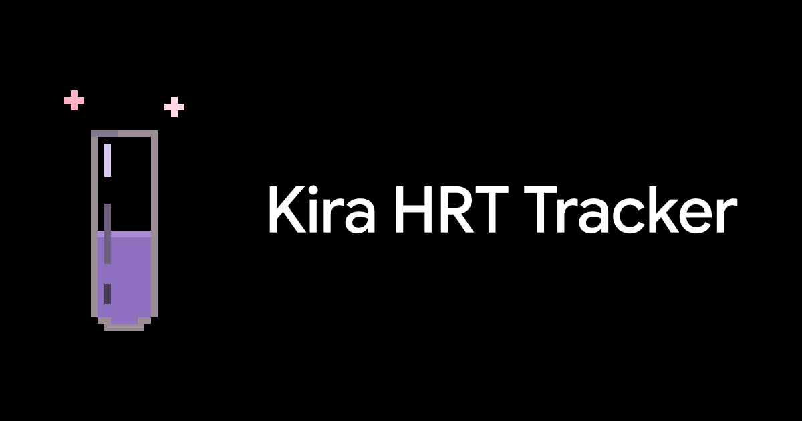

# Kira HRT Tracker

[English](README.en.md) · **中文**



**记录 HRT 用药与化验 → 用群体药代动力学模型估算激素曲线 → 用你自己的化验结果校准 → 让 AI 助手经 MCP 读写同一份记录。**

Web 应用、Android 应用、MCP 服务端共用一套「应用内核」，云端同步、逐帐户加密。

出品 **[KiraEqual](https://kiramyao.com)** · 服务状态 <https://status.kiramyao.com>

> ⚠️ 估算来自**群体药代动力学模型**，不是化验结果，**不能作为用药依据**。要知道真实血药浓度只能抽血，请始终以医院报告为准。

---

## 目录

- [这是什么](#这是什么)
- [功能](#功能)
- [架构](#架构)
- [两套药代动力学模型与校准](#两套药代动力学模型与校准)
- [AI 助手（MCP）](#ai-助手mcp)
- [导入 / 导出](#导入--导出)
- [技术栈](#技术栈)
- [本地开发](#本地开发)
- [自行托管](#自行托管)
- [安全与隐私](#安全与隐私)
- [上游与致谢](#上游与致谢)
- [许可](#许可)

---

## 这是什么

一个 HRT 记录软件，围绕一条闭环：

**记下用药 → 模型估算血药浓度曲线 → 抽血后把结果填进去 → 模型调整得更贴近你本人**

它适合这样的人：正在用注射或凝胶，想知道「这周血药浓度大概在什么水平」「下次该什么时候抽血」「上次那个剂量是不是偏高」，并且希望这些记录能直接交给 AI 助手使用。

数据存在**你自己的账号**里，跨设备同步；没有第三方分析、没有广告。

## 功能

### 记录

- **用药**：注射 / 口服 / 舌下 / 凝胶 / 贴片。凝胶可记录产品、涂抹面积、同时涂抹的其他物质、洗去时间；舌下可选吸收等级。
- **贴片佩戴追踪**：贴上后总览显示已佩戴时长，可一键「摘下」，摘下会与对应的贴片关联。
- **化验结果**：浓度、单位（pg/mL、pmol/L、ng/dL、nmol/L）、监控项（肝功能、钾等）。
- **用药方案**：设定用药方式、首次时间、追加剂次、间隔、药物与剂量；支持「每日 N 次」「每 x 小时」「每 x 天」三种周期，逾期会在首页高亮并一键补记。
- **体感日记**：记录主观感受，与用药时间线并排查看。
- **快捷模板**：常用剂量存成模板，首页一键记录，带撤销。
- **批量添加**、**导入导出**。

### 估算与校准

- **浓度曲线**：折线或 K 线（OHLC）两种画法；当前水平、剂量级别参考。
- **个体化校准**：4 种估计器——关闭 / MIPD（MAP 拟合）/ EKF（扩展卡尔曼滤波）/ OU-Kalman（Ornstein–Uhlenbeck 动态校准）。每种都有实时模型预览动画。
- **两套引擎**可切换：内置引擎与 Transmtf 引擎，同一份记录给两条曲线。

### 提醒

- **复查提醒**：按 MtF.wiki 的建议周期提示查肝功能、钾、雌二醇等。
- **抗雄激素累计量**跟踪。
- **用药提醒**：本地按方案排程通知为主，服务器 FCM 补推为辅（**双重去重**）。通知语言跟随应用内语言设置。

### 化验单识别

拍下化验单，**在本机识别**（ONNX 检测 + 文字识别），图片不出设备。

### 账号、分享与同步

- **账号**：用户名 + 密码；X（Twitter）与 Google 登录可互为补充、可互相绑定。
- **设备会话列表**：查看并逐个注销登录过的设备。
- **云同步**：记录与设置跨设备同步（含用药方案）。
- **分享**：生成只读链接给医生或朋友，可设过期时间与密码，**只含你选择分享的内容**。
- **数据导出与删除**：一键导出全部数据；可彻底删除账号。

### 客户端

- **7 种语言**：简中、繁中、粤语、英、日、韩、土，按需加载。
- **Android 应用**：Tauri 打包，**应用内自更新**（下载并调起系统安装界面）、系统返回手势与预测式返回、外部链接走系统浏览器。
- **主题**：浅色 / 深色 / 跟随系统；跟随主题的启动过渡。
- **PWA**：离线可用，Service Worker 缓存。

---

## 架构

```
         AI 助手 (ChatGPT / Claude)            Web / Android
                  │                                  │
                  │  MCP over Streamable HTTP        │  REST
                  └──────────────┬───────────────────┘
                                 ▼
                     ┌───────────────────────┐
                     │   应用内核 (Core)      │   server/src/
                     │  AccountService        │   accounts.ts
                     │  MedicationService     │   core.ts
                     │  LabService            │   core.ts
                     │  TimelineService       │   core.ts
                     │  PKSimulationService    │   core.ts
                     │  MedPlanService        │   core.ts
                     └────┬─────────────┬─────┘
                          ▼             ▼
                  ┌──────────────┐  ┌──────────────┐
                  │  PostgreSQL  │  │   PK 引擎     │
                  │  (密文)      │  │  logic.ts     │
                  └──────────────┘  └──────────────┘
```

**核心原则：MCP 不是后端，它和 REST 一样，都是应用内核之上的一层适配器。** 两条路径都把凭证解析成 `AuthContext`，再调用同一批服务函数——「记录一次用药」这件事只有一个实现。这样就不会出现 Web 路径和助手路径各自校验、各自计算、慢慢漂移，最后只在一侧有 bug 的情况。

- `server/src/http.ts` 与 `server/src/mcp.ts` **不含业务规则**；任何「记录如何校验」「曲线如何计算」的逻辑都属于 `core.ts`。
- **前端**（React SPA）与 **Android**（Tauri）共用同一份前端代码，只按平台分叉原生能力（通知、更新、返回手势、外部链接）。
- **加密在写入层**：记录以密文入库，`user_id` 与 `occurred_at` 是仅有的明文列，其余临床内容都在信封里。

更完整的设计说明见 **[`server/ARCHITECTURE.md`](server/ARCHITECTURE.md)**。

---

## 两套药代动力学模型与校准

曲线来自模型，而模型是**别人**的贡献。本应用提供两套，在「设置 → 常规设置」里随时切换：

| 模型 | 来源 | 说明 |
|---|---|---|
| **内置（原有）** | [@LaoZhong-Mihari](https://github.com/LaoZhong-Mihari/HRT-Recorder-PKcomponent-Test) 的 `PKcore.swift` / `PKparameter.swift`，**原样移植、不改动** | 雌二醇 + 睾酮 + 抗雄激素 |
| **Transmtf** | [Transmtf Team](https://github.com/TransmtfTeam/Transmtf-HRT-Tracker)（MIT），在同一套算法上扩展 | 只建模雌二醇与两种抗雄激素，**无睾酮模型** |

两套模型对同一份记录**算出不同的曲线**——这不是 bug，正是提供选择的原因。注射类往往一致，凝胶与舌下差异明显。Transmtf 引擎只建模雌二醇，所以在男性化模式下不可选。

**校准**用你的化验值反过来调整模型参数，四种估计器各自实现：MAP 拟合、扩展卡尔曼滤波、Ornstein–Uhlenbeck 动态校准。引擎选择与「男性化模式强制用内置引擎」的规则集中在 `src/engine/registry.ts` 一处。

---

## AI 助手（MCP）

服务端实现了 [MCP](https://modelcontextprotocol.io)。在应用里签一个令牌，填进客户端配置：

```json
{
  "mcpServers": {
    "hrt": {
      "type": "http",
      "url": "https://your-api-host/hrt/mcp",
      "headers": { "Authorization": "Bearer hrt_..." }
    }
  }
}
```

**21 个工具**，覆盖读写两侧：

| 读取 | 写入 / 管理 |
|---|---|
| `hrt_get_timeline` | `hrt_add_medication` |
| `hrt_list_medications` | `hrt_add_lab_result` |
| `hrt_list_labs` | `hrt_add_journal_entry` |
| `hrt_list_journal` | `hrt_add_dose_template` |
| `hrt_list_dose_templates` | `hrt_update_settings` |
| `hrt_predict_levels` | `hrt_delete_record` |
| `hrt_check_advisories` | `hrt_create_share` |
| `hrt_med_plan_status` | `hrt_list_shares` |
| `hrt_get_settings` | `hrt_revoke_share` |
| `hrt_sync_state` / `hrt_reference` | |

工具**清单**可匿名读取（只有 schema），**调用**一律需要令牌。令牌可撤销、可过期；改密码会终止全部令牌。

助手**可以读**当前用的是哪套模型（用来解释曲线），但**不能替你改**——换模型会重算全部历史估算，这是你看着曲线该做的决定。

**一条边界**：令牌是「面向记录的完整凭证」，但**改不了账号身份**——改密码、注销会话、绑定/解绑登录方式、删除账号、管理令牌都只在 Web 端，没有对应的 MCP 工具。完整工具表见 **[`server/MCP.md`](server/MCP.md)**。

---

## 导入 / 导出

**从别的记录应用搬过来**：设置 → 数据管理 → 导入数据，选文件即可。支持

- **[Oyama's HRT Tracker](https://github.com/xunxunProjects/Oyama-s-HRT-Tracker)** 的 JSON，含密码加密导出的（本项目分叉自它，信封格式完全相同）；
- **[Transmtf HRT Tracker](https://github.com/TransmtfTeam/Transmtf-HRT-Tracker)** 的 JSON，含密码加密导出的；
- **[Featherline](https://github.com/mkx173/Featherline)** 的 `.hrtbackup` 备份文件（输入备份密码）。

用药与化验一并带过来。Featherline 的自定义凝胶产品目录本应用无法表示，会跳过并告知跳过了几条——记录本身的剂量、途径、部位都保留。

**搬出去**：导出为 JSON，格式公开且稳定。

**给其他记录应用的作者**：请先看
**[`docs/hrt-import-export-protocol.zh-CN.md`](docs/hrt-import-export-protocol.zh-CN.md)**
（**中文操作指南**：字段对照表、示例代码、自测步骤、可直接粘给 AI 助手的提示词）。字段的权威定义在英文规范
**[`docs/hrt-import-export-protocol.md`](docs/hrt-import-export-protocol.md)**——最小必需字段、完整字段表、`route`/`Ester` 枚举取值、单位约定（`timeH` 是 1970 年起的小时、`doseMG` 是药物本身的毫克数而非 E₂ 当量）、可选加密信封的规格，以及一份最小可用的示例 JSON。

---

## 技术栈

| 层 | 技术 |
|---|---|
| 前端 | React 19 · TypeScript 7 · Vite 8 · Tailwind CSS（Material Design 3 令牌与组件） |
| 原生 | Tauri 2（Android）· Kotlin 桥（更新、返回手势、推送、安全区） |
| 后端 | Node.js · PostgreSQL · 原生 `pg`（无 ORM） |
| 协议 | REST + [MCP](https://modelcontextprotocol.io)（Streamable HTTP） |
| 加密 | 逐帐户 DEK；口令 KEK + OCI KMS 主密钥（HSM）双重包裹 |
| PK 引擎 | 上游 `logic.ts`（原样）· `src/pk/` 内的 Transmtf 引擎（懒加载） |
| 识别 | onnxruntime-web（检测）+ tesseract.js（文字），**全部在本机** |
| 推送 | 本地排程通知（Tauri 插件）+ FCM 补推（HTTP v1，`node:crypto` 签 JWT） |
| PWA | vite-plugin-pwa（Workbox）|
| i18n | 自建的 7 语言包，按需懒加载 |

## 本地开发

```bash
npm install

# 前端开发服务器（需要 API 地址）
VITE_API_ORIGIN=http://localhost:8788/hrt npm run dev

# 类型检查
npx tsc --noEmit

# 前端构建（VITE_API_ORIGIN 必填，构建脚本会强制校验）
VITE_API_ORIGIN=https://your-api-host/hrt npm run build
```

服务端见 **[`server/ARCHITECTURE.md`](server/ARCHITECTURE.md)** 的「Running it」，测试为 `cd server && npm test`（内置 embedded-postgres）。

Android 构建（仅 arm64）：

```bash
export ANDROID_HOME="$LOCALAPPDATA/Android/Sdk"
export NDK_HOME="$ANDROID_HOME/ndk/<version>"
export JAVA_HOME="/path/to/jdk-17"
export VITE_API_ORIGIN=https://your-api-host/hrt
node_modules/.bin/tauri android build --apk --target aarch64
```

## 自行托管

前端是静态构建，后端是 `server/` 里的 Node 服务，只需要一个 PostgreSQL。

完整手册见 **[`server/DEPLOY.md`](server/DEPLOY.md)**（数据库、systemd、Caddy 反向代理、KMS 配置、云端密钥、部署前检查、Android 发布流程）。

---

## 安全与隐私

- **逐帐户加密**：每条记录由该帐户自己的数据密钥（DEK）加密；DEK 由口令派生的 KEK 与服务端 OCI KMS 主密钥（存于 HSM，机箱上不落密钥材料）分别包裹。
- **失窃数据库不可读**：没有部署的密钥材料，数据库转储只是一堆密文。
- **诚实边界**：这不是「服务端永远看不到数据」的零知识方案。一旦 AI 助手进入数据路径，明文就会进入模型提供商的上下文——严格的端到端加密无法穿过一个助手，本项目不作此承诺。
- **无 SQL 级统计**：服务端无法从密文里聚合剂量或化验；唯一公开的聚合是 `/stats`（只有计数，无标识）。
- **撤销**：令牌可撤销；改密码会重写 DEK 包裹（一行改动，不会半途失败）并终止全部令牌。

安全报告方式见 **[`SECURITY.md`](SECURITY.md)**。

## 上游与致谢

本项目的界面与思路**分叉自 [Oyama's HRT Tracker](https://github.com/xunxunProjects/Oyama-s-HRT-Tracker)**，在此致谢。那是一个很完整的作品——有账号、有后端、有分享链接、也有多语言，本项目是在它的基础上继续往前走的一支。

感谢 [@LaoZhong-Mihari](https://github.com/LaoZhong-Mihari/HRT-Recorder-PKcomponent-Test)：药代动力学算法、模型与参数是他的工作，本应用只是把它移植到 Web 上并继续维护。这份署名是许可要求，更是应该做的事。

也感谢 [Transmtf Team](https://github.com/TransmtfTeam/Transmtf-HRT-Tracker) 在算法上的扩展，以及 [MtF.wiki](https://mtf.wiki/)（CC BY-SA 4.0）与 [Transfeminine Science](https://transfemscience.org/) 提供的剂量与监测参考——**引用其公开的结论与数字，未转载其内容**。

完整许可清单在 **[`THIRD-PARTY-LICENSES.md`](THIRD-PARTY-LICENSES.md)**，应用内「设置 → 关于 → 开源许可」也逐条列明。运行时依赖的许可由 `scripts/gen-licences.mjs` 自动生成，不手工维护。

## 许可

本仓库以 **MIT** 发布，分叉来源的原始声明完整保留在 [`LICENSE`](LICENSE)。

**但请注意上游模型的非商业限制**：代码本身是 MIT，然而所依赖的药代动力学模型带有**非商业条款**，这限制了*整个应用*可以怎么用。若要用于收费产品，需先与版权持有人重新协商。详见 [`THIRD-PARTY-LICENSES.md`](THIRD-PARTY-LICENSES.md)。
