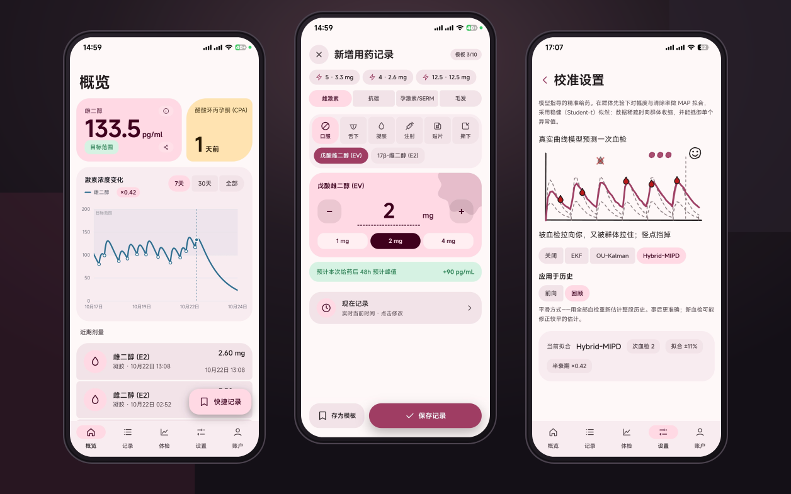
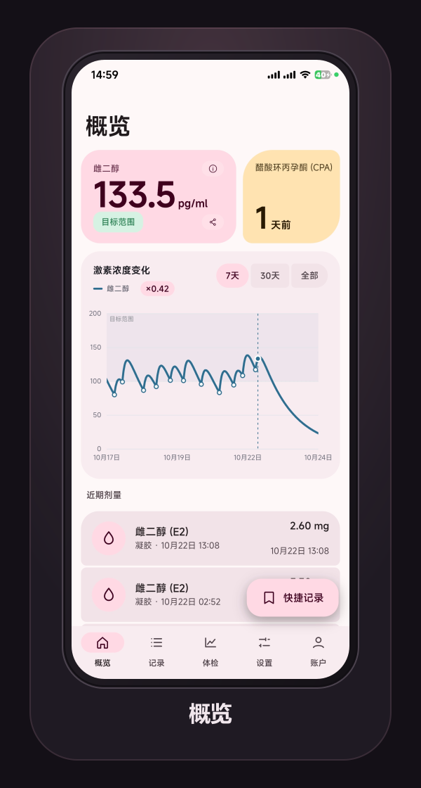
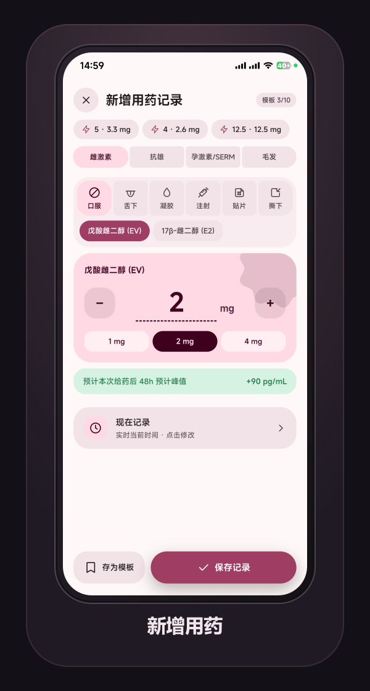
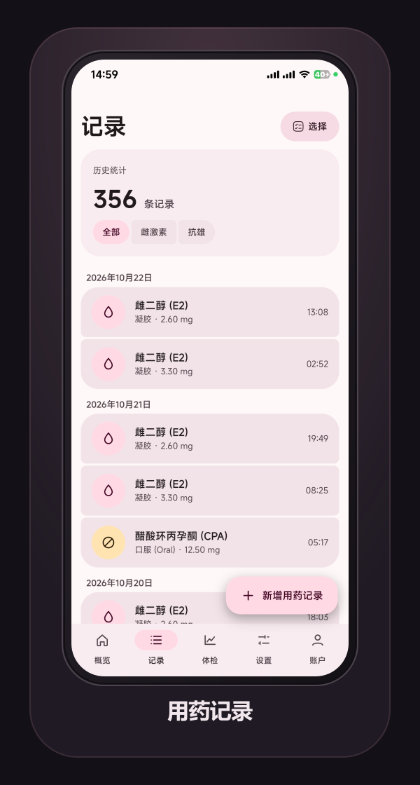
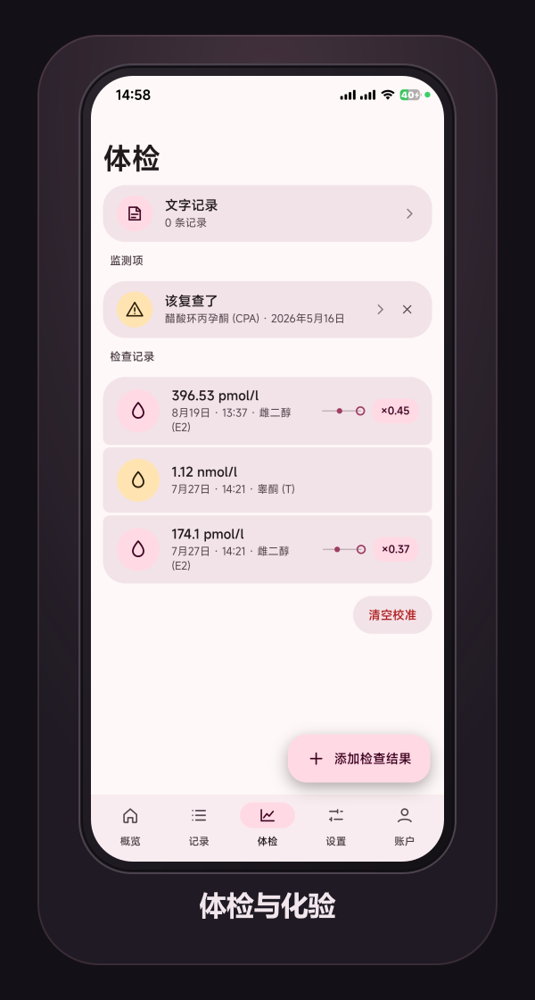
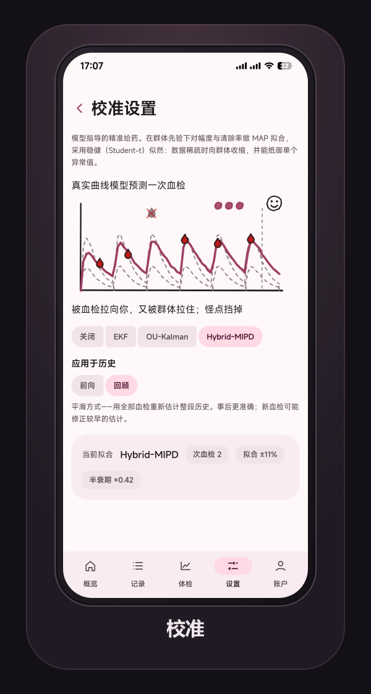
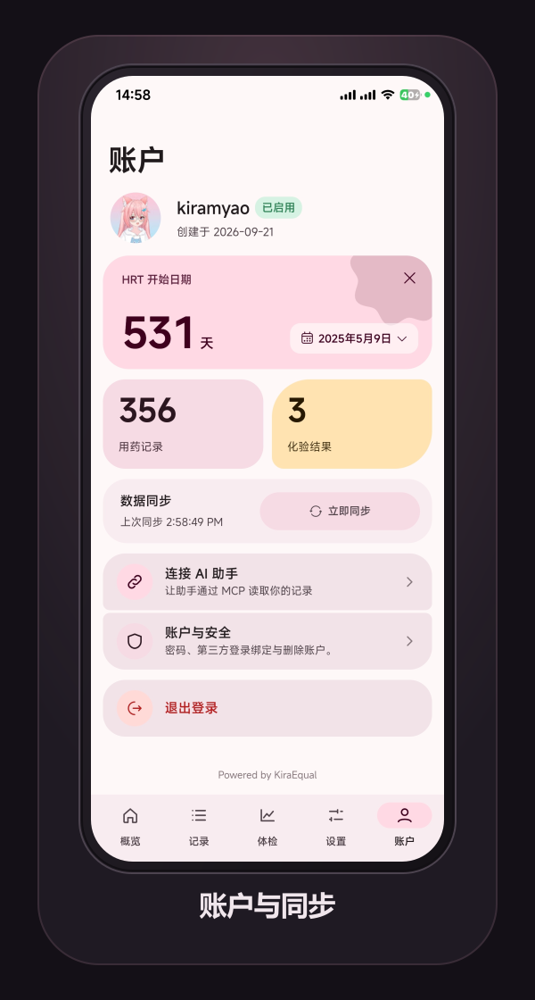

# Kira HRT Tracker

[English](README.en.md) · **中文**



**记录 HRT 用药与化验 → 用群体药代动力学模型估算激素曲线 → 用你自己的化验结果校准 → 让 AI 助手经 MCP 读写同一份记录。**

Web 应用、Android 应用、MCP 服务端共用一套「应用内核」，云端同步、逐帐户加密。

出品 **[KiraEqual](https://kiramyao.com)** · [介绍页](https://hrt.kiramyao.com/about/) · 服务状态 <https://status.kiramyao.com>

> ⚠️ 估算来自**群体药代动力学模型**，不是化验结果，**不能作为用药依据**。要知道真实血药浓度只能抽血，请始终以医院报告为准。

---

## 目录

- [这是什么](#这是什么)
- [功能](#功能)
- [截图](#截图)
- [关于](#关于)
- [架构](#架构)
- [两套药代动力学模型与校准](#两套药代动力学模型与校准)
- [AI 助手（MCP）](#ai-助手mcp)
- [导入 / 导出](#导入--导出)
- [技术栈](#技术栈)
- [本地开发](#本地开发)
- [自行托管](#自行托管)
- [安全与隐私](#安全与隐私)
- [上游与致谢](#上游与致谢)
- [许可](#许可)

---

## 这是什么

一个 HRT 记录软件，围绕一条闭环：

**记下用药 → 模型估算血药浓度曲线 → 抽血后把结果填进去 → 模型调整得更贴近你本人**

它适合这样的人：正在用注射或凝胶，想知道「这周血药浓度大概在什么水平」「下次该什么时候抽血」「上次那个剂量是不是偏高」，并且希望这些记录能直接交给 AI 助手使用。

数据存在**你自己的账号**里，跨设备同步；没有第三方分析、没有广告。

## 功能

### 记录

- **用药**：注射 / 口服 / 舌下 / 凝胶 / 贴片。凝胶可记录产品、涂抹面积、同时涂抹的其他物质、洗去时间；舌下可选吸收等级。
- **贴片佩戴追踪**：贴上后总览显示已佩戴时长，可一键「摘下」，摘下会与对应的贴片关联。
- **化验结果**：浓度、单位（pg/mL、pmol/L、ng/dL、nmol/L）、监控项（肝功能、钾等）。每条化验带**激素类型**（E2 / T / 未确认）；类型未确认的旧记录会保留但不参与校准，导入旧备份时可一次性确认按单位映射。
- **用药方案**：设定用药方式、首次时间、追加剂次、间隔、药物与剂量；支持「每日 N 次」「每 x 小时」「每 x 天」三种周期，逾期会在首页高亮并一键补记。方案列表与新增/编辑页会直接显示**下次和再下次提醒**的时间。
- **体感日记**：记录主观感受，与用药时间线并排查看。
- **快捷模板**：常用剂量存成模板，首页一键记录，带撤销。
- **批量添加**、**导入导出**。

### 估算与校准

- **浓度曲线**：折线或 K 线（OHLC）两种画法；当前水平、剂量级别参考。
- **个体化校准**：4 种估计器——关闭 / MIPD（MAP 拟合）/ EKF（扩展卡尔曼滤波）/ OU-Kalman（Ornstein–Uhlenbeck 动态校准）。每种都有实时模型预览动画。
- **估计背景 E2**：可信的给药前 E2 化验会估计一个背景浓度（中位数），拟合时扣除、输出时加回；没有给药前化验时背景为 0，不会凭空假定。界面会注明它可能包含历史给药残留，不是长期稳定基线的证明。
- **未确认类型的化验不参与校准**：旧备份没有激素类型时，导入预览可一次性按单位确认；否则保持“未确认”并从拟合中排除。
- **两套引擎**可切换：内置引擎与 Transmtf 引擎，同一份记录给两条曲线；两套都支持估计背景 E2。

### 提醒

- **复查提醒**：按 MtF.wiki 的建议周期提示查肝功能、钾、雌二醇等。
- **抗雄激素累计量**跟踪。
- **用药提醒**：网页端在页面可见时每 60 秒检查；APK 端改用系统排程未来 5 天（两条传输互斥，不会同时运行）。服务器 FCM 补推为辅（**双重去重**）。通知语言跟随应用内语言设置。

### 化验单识别

拍下化验单，**在本机识别**（ONNX 检测 + 文字识别），图片不出设备。

### 账号、分享与同步

- **账号**：用户名 + 密码；X（Twitter）与 Google 登录可互为补充、可互相绑定。绑定行显示各平台**自己的头像**（服务端按平台存一份，经本机取回转成 data URL 再显示）。
- **设备会话列表**：查看并逐个注销登录过的设备。
- **云同步**：记录与设置跨设备同步（含用药方案）。同步是**增量**的——服务端为每次写入打变更版本，客户端只拉取上次之后的变更、只上传本机改动过的记录，空闲同步几乎不产生流量。
- **分享**：生成只读链接给医生或朋友，可设过期时间与密码，**只含你选择分享的内容**。
- **数据导出与删除**：一键导出全部数据；可彻底删除账号。

### 客户端

- **7 种语言**：简中、繁中、粤语、英、日、韩、土，按需加载。
- **Android 应用**：Tauri 2 壳（`src-tauri/`，源码入库，`gen/` 与构建产物不入库）承载同一份 Web 前端，Kotlin 桥补齐原生能力：**应用锁**（生物识别 + 后台重锁）、预测式返回手势、系统文件导出、外部链接走系统浏览器。
- **两个渠道**：官网 / GitHub 的标准包带 FCM 补推与**应用内自更新**；商店渠道（用 `HRT_NO_FCM=1 VITE_NO_SELF_UPDATE=1` 构建）不含 Firebase，也不检查或安装更新——更新交给商店。
- **主题**：浅色 / 深色 / 跟随系统；跟随主题的启动过渡。
- **PWA**：离线可用，Service Worker 缓存。

### 下载安装

| 渠道 | 说明 |
|---|---|
| [网站](https://hrt.kiramyao.com) | Web 版可直接使用；Android 包与更新清单在同一目录 |
| [GitHub Releases](https://github.com/xingqimiao/Kira-HRT-Tracker/releases) | 每个版本的标准包，带更新说明与 sha256 |
| 商店渠道（F-Droid） | 无 Firebase、无自更新，更新由商店负责（**上架审核中**，暂请用前两个渠道） |

两个 Android 包用同一把签名密钥，可以互相覆盖安装，不需要先卸载。

---

## 截图

界面取自 Android 端的实际运行画面，与应用商店里的那套截图是同一批原图。图片由
`node scripts/generate-readme-shots.mjs` 从 `fastlane/metadata/android/` 合成，重新截图后重跑一次即可。

| | | |
|---|---|---|
| <br><sub>**概览** — 当前水平、目标范围、7 天 / 30 天 / 全部曲线</sub> | <br><sub>**新增用药** — 途径、药物、剂量，以及这次给药后的峰值预估</sub> | <br><sub>**用药记录** — 按天分组的完整时间线</sub> |
| <br><sub>**体检与化验** — 实测值与模型误差倍率、复查提醒</sub> | <br><sub>**校准** — 四种估计器，以及「前向 / 回顾」两种应用方式</sub> | <br><sub>**账户与同步** — 同步状态、AI 助手令牌、账号安全</sub> |

---

## 关于

面向使用者的完整说明在介绍页：**[中文](https://hrt.kiramyao.com/about/)** · **[English](https://hrt.kiramyao.com/about/en/)**，
同一份文字也收在仓库里（[`docs/about.md`](docs/about.md) / [`docs/about.en.md`](docs/about.en.md)）。
那份说明比这份 README 少讲实现、多讲「它怎么用、能回答什么问题」。

### 适合谁

正在用注射、凝胶、口服或贴片做激素治疗，想回答「这周血药浓度大概在什么水平」「上次那个剂量是不是偏高」
「下次该什么时候抽血」，并且希望这些记录不用手工整理成表格的人。

### 支持的药物

| 分类 | 可记录 |
|---|---|
| 雌激素 · 口服 / 舌下 | 戊酸雌二醇（EV）· 17β-雌二醇（E2） |
| 雌激素 · 凝胶 | 17β-雌二醇凝胶 · 戊酸雌二醇凝胶 |
| 雌激素 · 注射 | EV · 庚酸雌二醇（EN）· 环戊丙酸雌二醇（EC）· 苯甲酸雌二醇（EB）· 十一酸雌二醇（EU） |
| 雌激素 · 贴片 | 50 / 100 / 150 / 200 µg/天，以及「撕下」 |
| 抗雄激素 | 醋酸环丙孕酮（CPA）· 螺内酯 · 比卡鲁胺 · GnRH 类似物（仅记录） |
| 孕激素 / SERM | 微粉化黄体酮 · 雷洛昔芬 |
| 睾酮 · 凝胶 / 注射 / 胶囊 | 未酯化睾酮凝胶 · 环戊丙酸睾酮（TC）· 庚酸睾酮（TE）· 十一酸睾酮注射液 · 十一酸睾酮软胶囊 |
| 周期用药 | 醋酸甲羟孕酮（MPA）· 炔诺酮 |
| 毛发 | 非那雄胺 · 度他雄胺 |

这份列表随版本变化，以应用内实际可选的项目为准。

### 常见问题

**必须注册账号吗？**
不必。不登录时它是一本完整的离线记录本，只是不会跨设备同步。

**我的数据会被上传吗？**
只有在你登录并开启同步时，记录才会以加密形式传到服务器。照片、化验单图片始终留在设备上。

**估算准吗？**
群体模型的误差本来就不小，个体之间可以差出几倍。有化验结果之后，校准会把它拉近你自己；但仍然只是估算，不是化验值。

**换手机怎么办？**
登录同一账号即可同步；没有账号时用导出文件迁移。

---

## 架构

```
         AI 助手 (ChatGPT / Claude)            Web / Android
                  │                                  │
                  │  MCP over Streamable HTTP        │  REST
                  └──────────────┬───────────────────┘
                                 ▼
                     ┌───────────────────────┐
                     │   应用内核 (Core)      │   server/src/
                     │  AccountService        │   accounts.ts
                     │  MedicationService     │   core.ts
                     │  LabService            │   core.ts
                     │  TimelineService       │   core.ts
                     │  PKSimulationService    │   core.ts
                     │  MedPlanService        │   core.ts
                     └────┬─────────────┬─────┘
                          ▼             ▼
                  ┌──────────────┐  ┌──────────────┐
                  │  PostgreSQL  │  │   PK 引擎     │
                  │  (密文)      │  │  logic.ts     │
                  └──────────────┘  └──────────────┘
```

**核心原则：MCP 不是后端，它和 REST 一样，都是应用内核之上的一层适配器。** 两条路径都把凭证解析成 `AuthContext`，再调用同一批服务函数——「记录一次用药」这件事只有一个实现。这样就不会出现 Web 路径和助手路径各自校验、各自计算、慢慢漂移，最后只在一侧有 bug 的情况。

- `server/src/http.ts` 与 `server/src/mcp.ts` **不含业务规则**；任何「记录如何校验」「曲线如何计算」的逻辑都属于 `core.ts`。
- **Android 与 Web 共用同一份 React 界面**（Tauri 2 WebView 承载），只在原生桥（应用锁、通知、导出）处分叉；协议、加密信封与 PK 模型都有对齐的测试。
- **加密在写入层**：记录以密文入库，`user_id` 与 `occurred_at` 是仅有的明文列，其余临床内容都在信封里。

更完整的设计说明见 **[`server/ARCHITECTURE.md`](server/ARCHITECTURE.md)**。

---

## 两套药代动力学模型与校准

曲线来自模型，而模型设计源自**别人**的贡献。本应用提供两套，在「设置 → 常规设置」里随时切换：

| 模型 | 来源 | 说明 |
|---|---|---|
| **内置（原有）** | 模型设计源自 [@LaoZhong-Mihari](https://github.com/LaoZhong-Mihari/HRT-Recorder-PKcomponent-Test)；代码是本项目按隔室微分方程独立实现的（`src/pk/kernels.ts`），**未沿用上游代码** | 雌二醇 + 睾酮 + 抗雄激素 |
| **Transmtf** | [Transmtf Team](https://github.com/TransmtfTeam/Transmtf-HRT-Tracker)（MIT），在同一套算法上扩展 | 只建模雌二醇与两种抗雄激素，**无睾酮模型** |

两套模型对同一份记录**算出不同的曲线**——这不是 bug，正是提供选择的原因。注射类往往一致，凝胶与舌下差异明显。Transmtf 引擎只建模雌二醇，所以在男性化模式下不可选。

**校准**用你的化验值反过来调整模型参数，四种估计器各自实现：MAP 拟合、扩展卡尔曼滤波、Ornstein–Uhlenbeck 动态校准。两套引擎都会从**可信的给药前 E2 化验**估计「背景 E2」（中位数），拟合时扣除、输出时加回一次；没有这类化验时背景为 0，不会凭空假定。类型未确认（unknown）的化验不参与任何拟合。引擎选择与「男性化模式强制用内置引擎」的规则集中在 `src/engine/registry.ts` 一处。

---

## AI 助手（MCP）

服务端实现了 [MCP](https://modelcontextprotocol.io)。在应用里签一个令牌，填进客户端配置：

```json
{
  "mcpServers": {
    "hrt": {
      "type": "http",
      "url": "https://your-api-host/hrt/mcp",
      "headers": { "Authorization": "Bearer hrt_..." }
    }
  }
}
```

**19 个工具**，覆盖读写两侧；原始用药/化验读取只暴露最近 7 天，完整历史请用 Web 端：

| 读取 | 写入 / 管理 |
|---|---|
| `hrt_get_timeline` | `hrt_add_medication` |
| `hrt_list_medications` | `hrt_add_lab_result` |
| `hrt_list_labs` | `hrt_add_journal_entry` |
| `hrt_list_journal` | `hrt_add_dose_template` |
| `hrt_list_dose_templates` | `hrt_update_settings` |
| `hrt_predict_levels` | `hrt_delete_record` |
| `hrt_check_advisories` | `hrt_create_share` |
| `hrt_med_plan_status` | `hrt_list_shares` |
| `hrt_get_settings` | `hrt_revoke_share` |
| `hrt_reference` | |

工具**清单**可匿名读取（只有 schema），**调用**一律需要令牌。令牌可撤销、可过期；改密码会终止全部令牌。

助手**可以读**当前用的是哪套模型（用来解释曲线），但**不能替你改**——换模型会重算全部历史估算，这是你看着曲线该做的决定。

**一条边界**：令牌是「面向记录的完整凭证」，但**改不了账号身份**——改密码、注销会话、绑定/解绑登录方式、删除账号、管理令牌都只在 Web 端，没有对应的 MCP 工具。完整工具表见 **[`server/MCP.md`](server/MCP.md)**。

---

## 导入 / 导出

**从别的记录应用搬过来**：设置 → 数据管理 → 导入数据，选文件即可。支持

- **[Oyama's HRT Tracker](https://github.com/xunxunProjects/Oyama-s-HRT-Tracker)** 的 JSON，含密码加密导出的（本项目分叉自它，信封格式完全相同）；
- **[Transmtf HRT Tracker](https://github.com/TransmtfTeam/Transmtf-HRT-Tracker)** 的 JSON，含密码加密导出的；
- **[Featherline](https://github.com/mkx173/Featherline)** 的 `.hrtbackup` 备份文件（输入备份密码）。

用药与化验一并带过来，**保存好的用药模板、快捷剂量与体感日记也在内**。自定义凝胶产品目录会一并导入并持久化（产品 id ≥1000），所以记录里的剂量、途径、部位与产品名都不会丢。

每条化验带激素类型（`analyte`: E2 / T）。**旧备份没有这个字段时**，导入预览会出现一次性选项：按单位映射（`pg/ml`、`pmol/l` → E2；`ng/dl`、`nmol/l` → T）。勾选只影响本次导入；不勾选则记录保留为「未确认」，不进入校准，直到你在化验记录里确认类型。这个映射只是便利，不是单位正确性的证明。

**搬出去**：导出为 JSON，格式公开且稳定；已知类型的化验会带 `analyte`。

**给其他记录应用的作者**：请先看
**[`docs/hrt-import-export-protocol.zh-CN.md`](docs/hrt-import-export-protocol.zh-CN.md)**
（**中文操作指南**：字段对照表、示例代码、自测步骤、可直接粘给 AI 助手的提示词）。字段的权威定义在英文规范
**[`docs/hrt-import-export-protocol.md`](docs/hrt-import-export-protocol.md)**——最小必需字段、完整字段表（含 `analyte` 与旧备份兼容规则）、`route`/`Ester` 枚举取值、单位约定（`timeH` 是 1970 年起的小时、`doseMG` 是药物本身的毫克数而非 E₂ 当量）、可选加密信封的规格，以及一份最小可用的示例 JSON。

---

## 技术栈

| 层 | 技术 |
|---|---|
| 前端 | React 19 · TypeScript 7 · Vite 8 · Tailwind CSS（Material Design 3 令牌与组件） |
| 原生 | Tauri 2.12（`src-tauri/`）· Kotlin 桥（应用锁、导出、通知、返回手势、安全区） |
| 后端 | Node.js · PostgreSQL · 原生 `pg`（无 ORM） |
| 协议 | REST + [MCP](https://modelcontextprotocol.io)（Streamable HTTP） |
| 加密 | 逐帐户 DEK；口令 KEK + OCI KMS 主密钥（HSM）双重包裹 |
| PK 引擎 | 内置引擎：`logic.ts` + `src/pk/kernels.ts`（参数取自公开文献）· Transmtf 引擎：`src/pk/`（懒加载） |
| 识别 | PP-OCR（onnxruntime-web，检测 + 识别），**全部在本机** |
| 推送 | 本地精准闹钟（`AlarmManager`）+ FCM 补推（HTTP v1，`node:crypto` 签 JWT），两端去重共用一条账本 |
| PWA | vite-plugin-pwa（Workbox）|
| i18n | 自建的 7 语言包，按需懒加载 |

## 本地开发

```bash
npm install

# 前端开发服务器（需要 API 地址）
VITE_API_ORIGIN=http://localhost:8788/hrt npm run dev

# 类型检查
npx tsc --noEmit

# 前端构建（VITE_API_ORIGIN 必填，构建脚本会强制校验）
VITE_API_ORIGIN=https://your-api-host/hrt npm run build
```

服务端见 **[`server/ARCHITECTURE.md`](server/ARCHITECTURE.md)** 的「Running it」，测试为 `cd server && npm test`（内置 embedded-postgres）。

Android 构建（Tauri 2，JDK 17+ 与 Android SDK 37；`src-tauri/` 的源码在仓库里，`src-tauri/gen/` 由 Tauri 生成）：

```bash
export VITE_API_ORIGIN=https://api.example.com/hrt
npm run build:android
node_modules/.bin/tauri android build --apk --target aarch64
# 未签名产物：src-tauri/gen/android/app/build/outputs/apk/universal/release/app-universal-release-unsigned.apk
```

商店渠道（F-Droid）构建：在同样的命令前加两个环境变量，并用 `--config` 覆盖版本名，仓库里的版本号保持不变。
下面的 `2.1.0` 是示例，跟着本次要发布的版本走。

```bash
export HRT_NO_FCM=1 VITE_NO_SELF_UPDATE=1
node_modules/.bin/tauri android build --apk --target aarch64 \
  --config '{"version":"2.1.0-fdroid"}'
# versionName=2.1.0-fdroid, versionCode=2001000
```

签名与发布流程见 `server/DEPLOY.md` §4b。

## 自行托管

独立的 **Web/PWA 自部署发行包**保留多账号、同步、分享、MCP 和离线化验单识别。需要 Docker Compose v2，支持 Linux amd64、arm64，无需 Oracle、Firebase 或第三方登录账号。

**服务器和局域网已拆成独立教程，只选择与你场景相符的一篇：**

- **[公网服务器部署](deploy/self-host/SERVER.md)**：自己的域名 → DNS / 80、443 → 登录服务器 → 安装 → 自动 HTTPS，无需手动安装根证书。
- **[局域网 / NAS 部署](deploy/self-host/LAN.md)**：固定 IP → Windows/macOS/NAS 准备 → 安装 → 每台设备信任本地证书。
- [备份、升级、恢复与故障处理](deploy/self-host/MAINTENANCE.md)：安装完成后使用。

[下载 2.4.0 部署包](https://github.com/xingqimiao/Kira-HRT-Tracker/releases/download/self-host-v2.3.2/kira-hrt-self-host-2.3.2.tar.gz)。同一个包包含中英文的两条安装路线及维护文档，具体命令在各自教程中。[部署总入口](deploy/self-host/README.md) 说明如何选择场景。

GitHub 两个 Packages 是网页及 HTTPS 的 `kira-hrt-web` 和后端 `kira-hrt-api`，安装时连同 PostgreSQL 自动下载，不用二选一。已有实例按[维护文档](deploy/self-host/MAINTENANCE.md)的升级命令切到 2.4.0 即可，不需要重新初始化；旧版本部署包仍保留。

默认关闭 OAuth、验证码、FCM 和官网更新入口。官网 Android APK 仍连接官网，自部署手机端使用 Web/PWA。官网迁移通过导出、导入，不能直接复制 OCI 数据库后切换密钥提供方。主密钥和数据库都需要备份，密钥副本与数据库副本分开保管。

[验证记录](deploy/self-host/VERIFICATION.md) 说明验收范围；OCI/systemd 定制部署维护者可参考 [旧部署手册](server/DEPLOY.md)。

---

## 安全与隐私

- **逐帐户加密**：每条记录由该帐户自己的数据密钥（DEK）加密；DEK 由口令派生的 KEK 与部署主密钥分别包裹。官网使用 OCI KMS/HSM；自部署默认使用本地 AES-256-GCM 主密钥文件，与服务器处于同一管理边界，不具备云 HSM 的隔离能力。
- **失窃数据库不可读**：没有部署的密钥材料，数据库转储只是一堆密文。
- **诚实边界**：这不是「服务端永远看不到数据」的零知识方案。一旦 AI 助手进入数据路径，明文就会进入模型提供商的上下文——严格的端到端加密无法穿过一个助手，本项目不作此承诺。
- **无 SQL 级统计**：服务端无法从密文里聚合剂量或化验；唯一公开的聚合是 `/stats`（只有计数，无标识）。
- **撤销**：令牌可撤销；改密码会重写 DEK 包裹（一行改动，不会半途失败）并终止全部令牌。

安全报告方式见 **[`SECURITY.md`](SECURITY.md)**。

## 上游与致谢

本项目的界面与思路**分叉自 [Oyama's HRT Tracker](https://github.com/xunxunProjects/Oyama-s-HRT-Tracker)**，在此致谢。那是一个很完整的作品——有账号、有后端、有分享链接、也有多语言，本项目是在它的基础上继续往前走的一支。

感谢 [@LaoZhong-Mihari](https://github.com/LaoZhong-Mihari/HRT-Recorder-PKcomponent-Test)：药代动力学模型的设计来自他的工作。曲线的闭式解现在由本项目按隔室微分方程独立实现，参数改为直接取自公开文献；模型设计上的署名仍然应该保留，也仍然是荣誉性的。

也感谢 [Transmtf Team](https://github.com/TransmtfTeam/Transmtf-HRT-Tracker) 在算法上的扩展，以及 [MtF.wiki](https://mtf.wiki/)（CC BY-SA 4.0）与 [Transfeminine Science](https://transfemscience.org/) 提供的剂量与监测参考——**引用其公开的结论与数字，未转载其内容**。

完整许可清单在 **[`THIRD-PARTY-LICENSES.md`](THIRD-PARTY-LICENSES.md)**，应用内「设置 → 关于 → 开源许可」也逐条列明。运行时依赖的许可由 `scripts/gen-licences.mjs` 自动生成，不手工维护。

## 许可

本仓库以 **GPL-3.0 或更新版本**发布，完整文本在 [`LICENSE`](LICENSE)。之所以是 GPL：本应用的备份格式读取器派生自 Featherline（GPL-3.0）。各来源的原始声明（Oyama MIT、Transmtf MIT）逐条保留在 [`THIRD-PARTY-LICENSES.md`](THIRD-PARTY-LICENSES.md)。

药代动力学模型不再带有上游的非商业限制：出厂代码是独立实现，参数引用公开文献。F-Droid 重新提交的前提由此满足。
